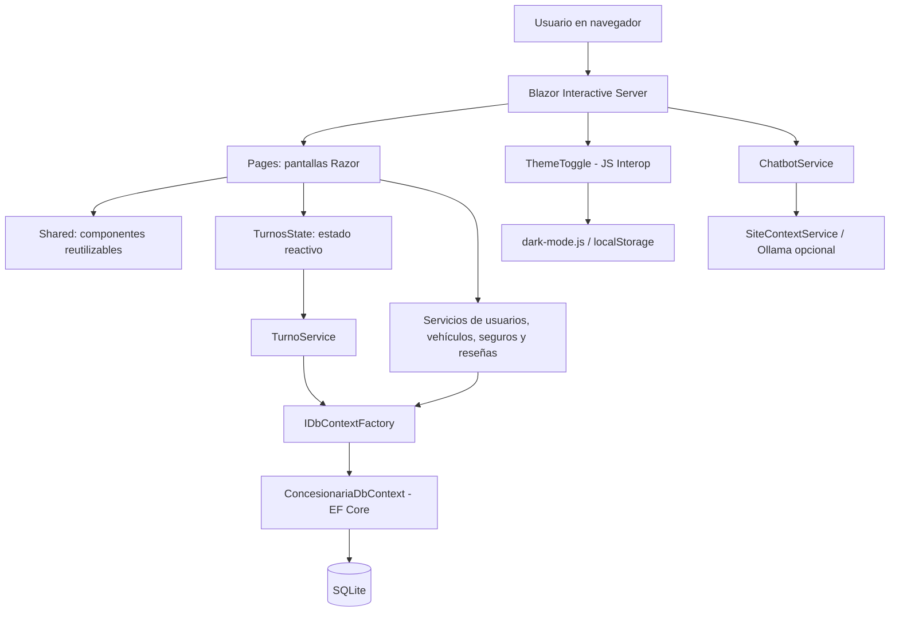
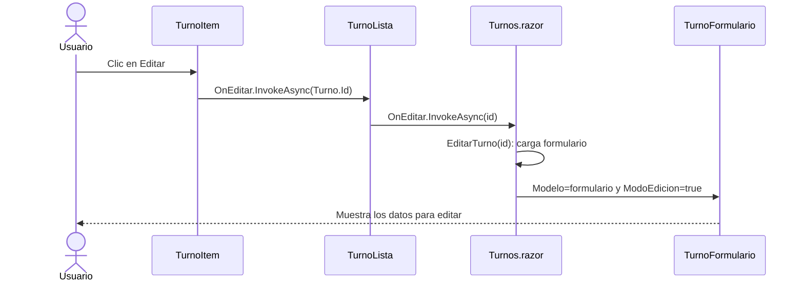
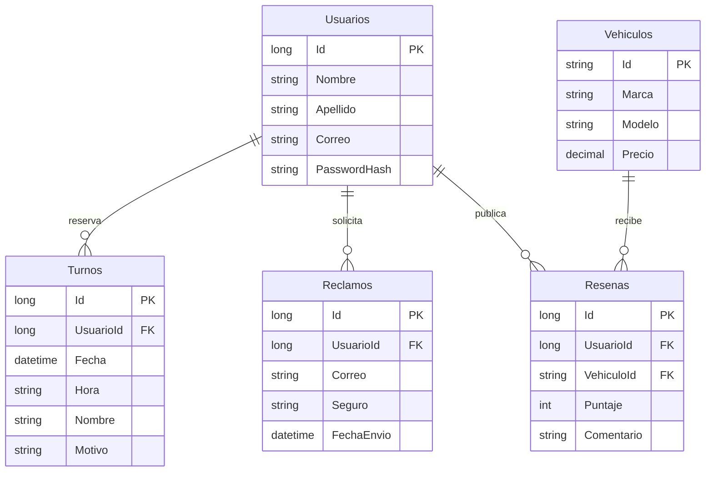

# Premium Quality Concesionaria

**Proyecto integrador — Desarrollo Web con Blazor | Tecnicatura Superior en Programación**

Aplicación web de una concesionaria de vehículos desarrollada en **C#, ASP.NET Core y Blazor Web App (.NET 10, modo Interactive Server)**. Permite consultar un catálogo de automóviles, filtrar y comparar modelos, registrar cuentas de usuario, administrar reservas de turnos, enviar solicitudes de seguros y publicar reseñas. Incluye un modo oscuro persistente, un chatbot contextual y persistencia con **Entity Framework Core 10 y SQLite**.

**Repositorio:** [github.com/nosoynacho/PremiumQuality-Concesionaria](https://github.com/nosoynacho/PremiumQuality-Concesionaria)  
**Integración continua:** [GitHub Actions](https://github.com/nosoynacho/PremiumQuality-Concesionaria/actions)  
**Rúbrica utilizada:** documentos de cátedra *Desarrollo Web con Blazor*, unidades 1, 2, 3 y 4, más la tabla del Proyecto Integrador de la Unidad 4.

> **Alcance:** la sección de compra es una **simulación**: no procesa pagos reales. El chatbot puede conectarse a un modelo Ollama instalado localmente. El repositorio contiene el código fuente; **una publicación exitosa con `dotnet publish` no equivale por sí sola a una aplicación alojada en Internet**.

---

## 1. Funcionalidades y ubicación de cada módulo

| Sección | Ruta web | Archivo | Funcionalidad |
|---|---|---|---|
| Inicio | `/` | [`Components/Pages/Home.razor`](Components/Pages/Home.razor) | Presentación de la concesionaria. |
| Modelos | `/modelos` | [`Components/Pages/Modelos.razor`](Components/Pages/Modelos.razor) | Catálogo, filtros, búsqueda, orden por precio, comparación, detalle y simulación de compra. |
| Contacto | `/contacto` | [`Components/Pages/Contacto.razor`](Components/Pages/Contacto.razor) | Datos de contacto y mapa. |
| Registro | `/registrarse` | [`Components/Pages/Registrarse.razor`](Components/Pages/Registrarse.razor) | Alta de cuentas con datos personales, contraseña y PIN de recuperación. |
| Inicio de sesión | `/iniciar-sesion` | [`Components/Pages/IniciarSesion.razor`](Components/Pages/IniciarSesion.razor) | Acceso con autenticación por cookies. |
| Recuperación | `/recuperar-password` | [`Components/Pages/RecuperarPassword.razor`](Components/Pages/RecuperarPassword.razor) | Restablecimiento de contraseña mediante correo y PIN. |
| Mi cuenta | `/mi-cuenta` | [`Components/Pages/MiCuenta.razor`](Components/Pages/MiCuenta.razor) | Información de la cuenta y opciones de sesión. |
| Turnos | `/turnos` | [`Components/Pages/Turnos.razor`](Components/Pages/Turnos.razor) | CRUD completo de reservas, búsqueda, paginación y confirmación de eliminación. |
| Seguros | `/seguros` | [`Components/Pages/Seguros.razor`](Components/Pages/Seguros.razor) | Formulario para solicitudes y consulta del historial personal. |
| Reseñas | `/resenas` | [`Components/Pages/Resenas.razor`](Components/Pages/Resenas.razor) | Consultar, publicar y eliminar reseñas propias vinculadas a vehículos. |
| Chatbot | Componente compartido | [`Components/Shared/Chatbot.razor`](Components/Shared/Chatbot.razor) | Asistencia contextual; IA local opcional mediante Ollama. |

El catálogo incluye seis vehículos precargados con EF Core. Las páginas de cuenta, turnos, seguros y reseñas se protegen con autenticación. Las rutas se definen mediante `@page`; la navegación está organizada con [`Components/Routes.razor`](Components/Routes.razor), [`Components/Layout/NavMenu.razor`](Components/Layout/NavMenu.razor) y los mecanismos de navegación de Blazor.

## 2. Tecnologías

| Tecnología | Utilidad | Evidencia |
|---|---|---|
| C# / .NET 10 | Lenguaje y plataforma de ejecución | [`blazornacho.csproj`](blazornacho.csproj): `net10.0`. |
| ASP.NET Core / Blazor | Componentes Razor con interactividad del servidor | [`Program.cs`](Program.cs), `Components/Pages/*.razor`. |
| Razor Components | Separación en componentes y comunicación por parámetros y eventos | [`Components/Shared/`](Components/Shared/). |
| HTML5 y CSS3 | Estructura semántica, estilos y diseño adaptable | [`Components/Layout/`](Components/Layout/), [`wwwroot/concesionaria.css`](wwwroot/concesionaria.css). |
| Bootstrap **5.3.3** | Sistema de grilla, formularios, botones y utilidades responsive | [`wwwroot/lib/bootstrap/`](wwwroot/lib/bootstrap/), [`Components/App.razor`](Components/App.razor). |
| CSS Isolation | Estilos exclusivos de determinados componentes | Archivos `*.razor.css`. |
| JavaScript ES6 / JS Interop | Gestión del modo oscuro y API `localStorage` | [`ThemeToggle.razor`](Components/Shared/ThemeToggle.razor), [`dark-mode.js`](wwwroot/dark-mode.js). |
| Entity Framework Core 10 | ORM, mapeo relacional, consultas y migraciones | [`Data/ConcesionariaDbContext.cs`](Data/ConcesionariaDbContext.cs). |
| SQLite | Almacenamiento relacional de la aplicación | Configuración en [`Program.cs`](Program.cs). |
| Autenticación por cookies | Inicio de sesión, cierre y acceso a rutas protegidas | [`Program.cs`](Program.cs), [`AuthEndpoints.cs`](Components/Services/AuthEndpoints.cs). |
| Git y GitHub Actions | Versionado, ramas, Pull Requests y compilación automática | [Historial](https://github.com/nosoynacho/PremiumQuality-Concesionaria/commits/main), [CI](.github/workflows/ci.yml). |
| Ollama (opcional) | Modelo de IA local para el chatbot | [`LocalAiService.cs`](Components/Services/LocalAiService.cs). |

## 3. Arquitectura del proyecto

El proyecto organiza el código según responsabilidades. Los componentes Razor presentan los datos y reciben eventos; los servicios aplican la lógica y consultan entidades; EF Core traduce operaciones de C# a consultas SQL ejecutadas por SQLite.



### Carpetas importantes

```text
blazornacho/
├── .github/workflows/ci.yml          # GitHub Actions (CI)
├── Components/
│   ├── App.razor                     # HTML raíz y enlaces CSS/Bootstrap
│   ├── Routes.razor                  # Enrutamiento de Blazor
│   ├── Layout/                       # MainLayout, NavMenu y CSS aislado
│   ├── Pages/                        # Pantallas accesibles por URL
│   ├── Shared/                       # Componentes reutilizables
│   ├── Models/                       # Entidades, formularios y resultados
│   └── Services/                     # Servicios, estado, autenticación y chatbot
├── Data/
│   ├── ConcesionariaDbContext.cs     # DbSet y configuración de relaciones
│   └── ConcesionariaDbContextFactory.cs
├── Migrations/                       # Evolución versionada de la base
├── wwwroot/
│   ├── lib/bootstrap/               # Bootstrap 5.3.3 local
│   ├── app.css
│   ├── concesionaria.css
│   ├── dark-mode.css
│   ├── dark-mode.js
│   └── img/
├── appsettings.json                  # Configuración de la aplicación
├── appsettings.Development.json
├── Program.cs                        # Registro de servicios y middleware
├── blazornacho.csproj
└── README.md
```

En [`Program.cs`](Program.cs) se configuran el renderizado interactivo, la autenticación por cookies, la autorización, la protección antifalsificación, la fábrica de `DbContext`, los servicios `AddScoped`, las migraciones y los endpoints de autenticación. La aplicación utiliza `app.MapRazorComponents<App>().AddInteractiveServerRenderMode()`.

---

## 4. Componentes reutilizables: dónde se llaman y cómo intercambian datos

**Página coordinadora:** [`Components/Pages/Turnos.razor`](Components/Pages/Turnos.razor). En ella se utilizan cinco componentes directamente. El sexto, `TurnoItem`, es instanciado por `TurnoLista`. Ninguno necesita copiar el código completo del otro: cada componente tiene una responsabilidad delimitada.

### 4.1. Los seis componentes exigidos por el integrador

| Componente | Archivo real | Dónde se utiliza | Datos que recibe (`[Parameter]`) | Eventos que devuelve (`EventCallback`) |
|---|---|---|---|---|
| **TurnoFormulario** | [`Components/Shared/TurnoFormulario.razor`](Components/Shared/TurnoFormulario.razor) | Directamente en `Turnos.razor` | `Modelo`, `Horarios`, `ModoEdicion`, `ErrorGeneral` | `OnGuardar`, `OnCancelar` |
| **TurnoLista** | [`Components/Shared/TurnoLista.razor`](Components/Shared/TurnoLista.razor) | Directamente en `Turnos.razor` | `Turnos` | `OnEditar`, `OnEliminar` (`long`) |
| **TurnoItem** | [`Components/Shared/TurnoItem.razor`](Components/Shared/TurnoItem.razor) | Dentro de `TurnoLista.razor`, en `@foreach` | `Turno` | `OnEditar`, `OnEliminar` (`long`) |
| **ConfirmacionModal** | [`Components/Shared/ConfirmacionModal.razor`](Components/Shared/ConfirmacionModal.razor) | Directamente en `Turnos.razor` | `Visible`, `Titulo`, `Mensaje` | `OnConfirmar`, `OnCancelar` |
| **AlertError** | [`Components/Shared/AlertError.razor`](Components/Shared/AlertError.razor) | En `Turnos.razor`, `Seguros.razor` y `Resenas.razor` | `Mensaje` | `OnCerrar` |
| **Paginacion** | [`Components/Shared/Paginacion.razor`](Components/Shared/Paginacion.razor) | Directamente en `Turnos.razor` | `PaginaActual`, `TotalPaginas` | `OnCambio` (`int`) |

También existen [`ThemeToggle.razor`](Components/Shared/ThemeToggle.razor) y [`Chatbot.razor`](Components/Shared/Chatbot.razor) como componentes independientes de interfaz.

### 4.2. Conceptos: `[Parameter]`, `@bind`, `EventCallback` y `@inject`

- **`[Parameter]`** declara una propiedad pública que un componente padre puede establecer en su componente hijo. Por ejemplo, `Modelo` recibe un `TurnoFormModel`.
- **`@bind-Value`** enlaza un control con una propiedad de C#. En el formulario, `@bind-Value="Modelo.Nombre"` mantiene sincronizado el campo con el objeto `Modelo` que recibió del padre.
- **`EventCallback`** notifica una acción al padre. `OnGuardar.InvokeAsync()` pide guardar; `OnEditar.InvokeAsync(Turno.Id)` devuelve el identificador del turno; `OnCambio.InvokeAsync(PaginaActual + 1)` comunica la página solicitada.
- **`@inject`** obtiene servicios registrados en el contenedor de inyección de dependencias. Por ejemplo, `@inject TurnosState TurnosState` permite que `Turnos.razor` acceda al estado.
- **`[CascadingParameter]`** se utiliza en `Turnos.razor` para recibir `AuthenticationStateTask` y determinar el usuario que inició sesión; no es el mecanismo que transmite los turnos entre los seis componentes.

**No hay una única «variable que hace viajar todo».** Los datos se transfieren con parámetros (`Modelo`, `Turnos`, `Turno`, `Mensaje`, etc.); las acciones se comunican con callbacks (`OnGuardar`, `OnEditar`, `OnCambio`); y el estado compartido se mantiene en `TurnosState`.

### 4.3. Ejemplo real: el padre llama a `TurnoFormulario`

En [`Turnos.razor`](Components/Pages/Turnos.razor):

```razor
<TurnoFormulario
    Modelo="formulario"
    Horarios="horarios"
    ModoEdicion="EstaEditando"
    ErrorGeneral="@errorTurno"
    OnGuardar="GuardarTurno"
    OnCancelar="CancelarEdicion" />
```

- `formulario` es un objeto `TurnoFormModel` que contiene fecha, hora, nombre, motivo e identificador cuando se está editando.
- `horarios` es una lista de horas que se generan en la página.
- `EstaEditando` indica si se modifica un turno existente.
- `GuardarTurno` es el método del **padre** que recibe el evento del hijo.

En [`TurnoFormulario.razor`](Components/Shared/TurnoFormulario.razor):

```csharp
[Parameter, EditorRequired]
public TurnoFormModel Modelo { get; set; } = new();

[Parameter]
public EventCallback OnGuardar { get; set; }

private Task Guardar() => OnGuardar.InvokeAsync();
```

Y en el marcado del hijo:

```razor
<InputText class="form-control" @bind-Value="Modelo.Nombre" />
```

**Secuencia:** el usuario escribe → Blazor actualiza `Modelo.Nombre` → se validan los datos del `EditForm` → `OnGuardar` ejecuta `GuardarTurno()` en `Turnos.razor` → se utiliza `TurnosState` → se consulta `TurnoService` → EF Core actualiza SQLite.

### 4.4. Ejemplo real: `TurnoLista` reutiliza `TurnoItem`

En [`Turnos.razor`](Components/Pages/Turnos.razor):

```razor
<TurnoLista
    Turnos="TurnosState.Turnos"
    OnEditar="EditarTurno"
    OnEliminar="SolicitarEliminar" />
```

En [`TurnoLista.razor`](Components/Shared/TurnoLista.razor):

```razor
@foreach (Turno turno in Turnos)
{
    <TurnoItem Turno="turno"
               OnEditar="Editar"
               OnEliminar="Eliminar" />
}
```

En [`TurnoItem.razor`](Components/Shared/TurnoItem.razor):

```csharp
[Parameter, EditorRequired]
public Turno Turno { get; set; } = default!;

[Parameter]
public EventCallback<long> OnEditar { get; set; }

private Task Editar() => OnEditar.InvokeAsync(Turno.Id);
```

**Secuencia al pulsar Editar:**



### 4.5. Modal, errores y paginación

**Eliminación:** `TurnoItem` envía `Turno.Id` → `TurnoLista` lo reenvía → `SolicitarEliminar(id)` en `Turnos.razor` guarda el valor en `idTurnoAEliminar` (`long?`) → `ConfirmacionModal` recibe `Visible="idTurnoAEliminar.HasValue"` → al confirmar se llama `ConfirmarEliminar()` y luego `TurnosState.Eliminar(id)`.

**Errores:** `Turnos.razor` establece la variable `mensajeError`; `<AlertError Mensaje="@mensajeError" OnCerrar="CerrarError" />` presenta el mensaje sin duplicar código de alerta. El mismo componente se utiliza en Seguros y Reseñas.

**Paginación:** `<Paginacion PaginaActual="TurnosState.PaginaActual" TotalPaginas="TurnosState.TotalPaginas" OnCambio="CambiarPagina" />` recibe dos números. Cuando el usuario pulsa Siguiente, `Paginacion.razor` llama `OnCambio.InvokeAsync(PaginaActual + 1)`; el padre ejecuta `CambiarPagina(int)` y solicita una nueva consulta a `TurnosState`.

### 4.6. State Service y actualización reactiva

Archivo: [`Components/Services/TurnosState.cs`](Components/Services/TurnosState.cs). Registro en [`Program.cs`](Program.cs):

```csharp
builder.Services.AddScoped<TurnosState>();
```

El servicio expone `Turnos`, `PaginaActual`, `TotalPaginas` y `TotalRegistros`, y declara:

```csharp
public event Action? OnChange;

private void NotificarCambio() => OnChange?.Invoke();
```

Cuando se crea, modifica o elimina un turno, el servicio utiliza `TurnoService` y después recarga los datos desde la BD. En [`Turnos.razor`](Components/Pages/Turnos.razor), la página se suscribe a `TurnosState.OnChange` durante `OnInitializedAsync()` y se desuscribe en `Dispose()`. Esto mantiene la vista actualizada y evita dejar suscripciones activas innecesariamente.

---

## 5. Bootstrap 5.3.3: ubicación, carga global y uso responsive

### 5.1. ¿Dónde está Bootstrap?

Los archivos de **Bootstrap 5.3.3** están incluidos localmente en:

```text
wwwroot/lib/bootstrap/dist/css/bootstrap.min.css
wwwroot/lib/bootstrap/dist/js/bootstrap.bundle.min.js
```

Se verificó la versión 5.3.3 en la cabecera del archivo CSS incluido. El proyecto trae los archivos, pero **eso no demuestra qué método se usó originalmente para obtenerlos** (plantilla, LibMan o copia manual).

### 5.2. ¿Dónde se incorpora a toda la aplicación?

En [`Components/App.razor`](Components/App.razor), dentro de `<head>`:

```html
<link rel="stylesheet" href="lib/bootstrap/dist/css/bootstrap.min.css" />
<link rel="stylesheet" href="app.css" />
<link rel="stylesheet" href="concesionaria.css" />
<link rel="stylesheet" href="dark-mode.css" />
<link rel="stylesheet" href="blazornacho.styles.css" />
```

Cuando el navegador carga `App.razor`, descarga `bootstrap.min.css` desde `wwwroot` y sus clases quedan disponibles **en todas las páginas y componentes**. No es necesario ejecutar `new Bootstrap()` ni registrar Bootstrap con `builder.Services`: es una hoja CSS cargada globalmente.

El archivo `bootstrap.bundle.min.js` existe en `wwwroot`, pero **no se encontró una etiqueta que lo cargue en `Components/App.razor`**. En particular, el modal de confirmación se controla con estado y eventos Blazor, no mediante la API JavaScript de Bootstrap. Para usar la grilla, los formularios y los botones CSS no es necesario cargar el bundle JavaScript.

### 5.3. ¿En qué componentes se usan sus clases?

| Archivo | Clases existentes | Aplicación |
|---|---|---|
| [`Modelos.razor`](Components/Pages/Modelos.razor) | `row`, `col-12`, `col-sm-6`, `col-lg-4`, `col-xl-3`, `g-4` | Catálogo con columnas según el ancho. |
| [`Turnos.razor`](Components/Pages/Turnos.razor) | `row g-2`, `col-12 col-md-8`, `col-12 col-md-4` | Buscador y botones que cambian su distribución. |
| [`TurnoFormulario.razor`](Components/Shared/TurnoFormulario.razor) | `form-control`, `form-label`, `mb-3`, `btn` | Campos y acciones del formulario. |
| [`TurnoItem.razor`](Components/Shared/TurnoItem.razor) | `btn btn-primary`, `btn btn-danger`, `mt-3` | Botones de Editar y Eliminar. |
| [`AlertError.razor`](Components/Shared/AlertError.razor) | `alert alert-danger`, `d-flex`, `btn-close` | Presentación de errores. |
| [`Paginacion.razor`](Components/Shared/Paginacion.razor) | `btn btn-outline-primary`, `d-flex`, `gap-3` | Controles de paginación. |

### 5.4. Ejemplo de la grilla responsive del catálogo

En [`Modelos.razor`](Components/Pages/Modelos.razor):

```html
<article class="col-12 col-sm-6 col-lg-4 col-xl-3 d-flex align-items-start">
```

Bootstrap utiliza una grilla de **12 columnas**:

| Clase | Ancho mínimo | Columnas que ocupa la tarjeta | Tarjetas que caben por fila |
|---|---|---:|---:|
| `col-12` | Desde móvil | 12/12 | 1 |
| `col-sm-6` | 576 px | 6/12 | 2 |
| `col-lg-4` | 992 px | 4/12 | 3 |
| `col-xl-3` | 1200 px | 3/12 | 4 |

En Turnos, `col-12 col-md-8` y `col-12 col-md-4` hacen que búsqueda y acciones ocupen toda la fila en móviles y se distribuyan en **8 + 4 columnas** desde 768 px.

### 5.5. CSS personalizado y CSS Isolation

- [`wwwroot/concesionaria.css`](wwwroot/concesionaria.css): estilos generales, Flexbox, Grid y reglas `@media` para distintos tamaños de pantalla; es **CSS responsive propio**, distinto de la grilla de Bootstrap.
- [`wwwroot/app.css`](wwwroot/app.css): estilos globales.
- [`wwwroot/dark-mode.css`](wwwroot/dark-mode.css): aspecto del tema oscuro.
- [`Components/Layout/MainLayout.razor.css`](Components/Layout/MainLayout.razor.css): layout.
- [`Components/Layout/NavMenu.razor.css`](Components/Layout/NavMenu.razor.css): navegación.
- [`Components/Shared/TurnoFormulario.razor.css`](Components/Shared/TurnoFormulario.razor.css): formulario.
- [`Components/Shared/TurnoItem.razor.css`](Components/Shared/TurnoItem.razor.css): tarjeta individual.
- [`Components/Shared/ConfirmacionModal.razor.css`](Components/Shared/ConfirmacionModal.razor.css): confirmación.
- [`Components/Layout/ReconnectModal.razor.css`](Components/Layout/ReconnectModal.razor.css): reconexión.

En total se incluyen **seis archivos de CSS Isolation**, frente al mínimo de tres de la Unidad 2. El compilador produce el paquete de estilos aislados que `App.razor` carga como `blazornacho.styles.css`.

**Cómo demostrar el responsive:** abrir `/modelos` y `/turnos` con herramientas de desarrollador de Chrome (`F12`, modo dispositivo) a 375 px, 768 px y 1366 px. La existencia de las clases responsive es verificable en el código; la visualización real se comprueba ejecutando la aplicación.

---

## 6. Formularios, validaciones y mensajes al usuario

### 6.1. Turnos: `EditForm` + Data Annotations

El componente [`TurnoFormulario.razor`](Components/Shared/TurnoFormulario.razor) utiliza:

```razor
<EditForm Model="Modelo" FormName="formTurno" OnValidSubmit="Guardar">
    <DataAnnotationsValidator />
    <!-- InputDate, InputSelect, InputText, InputTextArea -->
    <ValidationMessage For="@(() => Modelo.Nombre)" />
</EditForm>
```

Las reglas se declaran en [`Components/Models/TurnoFormModel.cs`](Components/Models/TurnoFormModel.cs):

- `Fecha`: `[Required]` y tipo fecha.
- `Hora`: `[Required]`.
- `Nombre`: `[Required]`, `[StringLength(80, MinimumLength = 3)]` y expresión regular de letras/espacios.
- `Motivo`: `[Required]` y longitud entre 5 y 250 caracteres.

Además, [`Turnos.razor`](Components/Pages/Turnos.razor) realiza validaciones de negocio: impide fechas anteriores a la actual y comprueba disponibilidad del mismo día y horario. En [`ConcesionariaDbContext.cs`](Data/ConcesionariaDbContext.cs) existe también un índice único sobre `(Fecha, Hora)`.

### 6.2. Cuentas, seguros y reseñas

| Formulario | Archivos | Técnica de validación |
|---|---|---|
| Registro | [`Registrarse.razor`](Components/Pages/Registrarse.razor), [`RegistroUsuarioModel.cs`](Components/Models/RegistroUsuarioModel.cs), [`AuthEndpoints.cs`](Components/Services/AuthEndpoints.cs) | Modelos validados en servidor; datos personales, correo, contraseña, confirmación y PIN. |
| Login | [`IniciarSesion.razor`](Components/Pages/IniciarSesion.razor), [`LoginUsuarioModel.cs`](Components/Models/LoginUsuarioModel.cs), [`UsuarioService.cs`](Components/Services/UsuarioService.cs) | Verificación de credenciales y mensajes. |
| Recuperación | [`RecuperarPassword.razor`](Components/Pages/RecuperarPassword.razor), [`RecuperarPasswordModel.cs`](Components/Models/RecuperarPasswordModel.cs) | Correo, PIN y contraseña nueva. |
| Seguros | [`Seguros.razor`](Components/Pages/Seguros.razor) | `EditForm`, `DataAnnotationsValidator`, nueve `ValidationMessage`, `[Required]`, `[EmailAddress]` y patrones para ciertos campos. |
| Reseñas | [`Resenas.razor`](Components/Pages/Resenas.razor), [`Resena.cs`](Components/Models/Resena.cs), [`ResenaService.cs`](Components/Services/ResenaService.cs) | Puntaje `[Range(1, 5)]`, comentario de 5 a 1000 caracteres validado en el modelo/servicio y mensajes de interfaz. |

No todos los formularios usan necesariamente `EditForm`: los formularios HTTP de autenticación se procesan mediante endpoints ASP.NET Core en `AuthEndpoints.cs`, y otras páginas combinan validación de interfaz con validación de modelo. Es importante distinguir estos mecanismos durante la defensa.

**Presentación de errores:** [`AlertError.razor`](Components/Shared/AlertError.razor) centraliza un mensaje con `role="alert"` y un botón de cierre; `Turnos.razor`, `Seguros.razor` y `Resenas.razor` utilizan manejo de excepciones para evitar dejar errores de persistencia sin comunicar.

---

## 7. Persistencia: SQLite, entidades y relaciones entre tablas

### 7.1. ¿Se utiliza SQL Server o SQLite?

El motor de datos de este proyecto es **SQLite**, no SQL Server. Ambas son bases de datos relacionales consultables mediante SQL; aquí la aplicación trabaja con SQLite a través del proveedor `Microsoft.EntityFrameworkCore.Sqlite` **10.0.9** declarado en [`blazornacho.csproj`](blazornacho.csproj).

[`Program.cs`](Program.cs) obtiene la cadena `ConnectionStrings:Default` (o utiliza `Data Source=Data/concesionaria.db` como alternativa de desarrollo) y registra:

```csharp
builder.Services.AddDbContextFactory<ConcesionariaDbContext>(
    options => options.UseSqlite(connectionString));
```

La fábrica `IDbContextFactory<ConcesionariaDbContext>` permite a cada servicio crear contextos de corta duración, apropiados para los circuitos interactivos de Blazor Server.

### 7.2. Entidades: clases C# que se transforman en tablas

En [`Data/ConcesionariaDbContext.cs`](Data/ConcesionariaDbContext.cs):

```csharp
public DbSet<Usuario> Usuarios => Set<Usuario>();
public DbSet<Vehiculo> Vehiculos => Set<Vehiculo>();
public DbSet<Resena> Resenas => Set<Resena>();
public DbSet<Turno> Turnos => Set<Turno>();
public DbSet<Reclamo> Reclamos => Set<Reclamo>();
```

| Entidad / tabla | Archivo del modelo | Clave primaria (PK) | Datos y relaciones principales |
|---|---|---|---|
| `Usuario` / `Usuarios` | [`Usuarios.cs`](Components/Models/Usuarios.cs) | `Id` (`long`) | Nombre, apellido, correo, hashes de contraseña/PIN; colecciones `Turnos`, `Reclamos`, `Resenas`. |
| `Vehiculo` / `Vehiculos` | [`Vehiculo.cs`](Components/Models/Vehiculo.cs) | `Id` (`string`) | Marca, modelo, año, precio, imagen y características; colección `Resenas`. |
| `Turno` / `Turnos` | [`Turno.cs`](Components/Models/Turno.cs) | `Id` (`long`) | Fecha, hora, nombre, motivo, `UsuarioId` (FK). |
| `Reclamo` / `Reclamos` | [`Reclamo.cs`](Components/Models/Reclamo.cs) | `Id` (`long`) | Datos de solicitud de seguro, fecha y `UsuarioId` (FK). |
| `Resena` / `Resenas` | [`Resena.cs`](Components/Models/Resena.cs) | `Id` (`long`) | Puntaje, comentario, fecha, `UsuarioId` (FK) y `VehiculoId` (FK). |

`DbSet<T>` representa el conjunto de entidades que EF Core consulta o modifica; no es, por sí solo, una conexión independiente a una tabla. Las restricciones, relaciones e índices se configuran mediante la **Fluent API** de `OnModelCreating` en el mismo `DbContext`.

### 7.3. Diagrama entidad-relación (ER)



### 7.4. Ejemplo detallado: Usuarios (1) → (N) Turnos

La relación **uno a muchos** significa que **un usuario puede reservar varios turnos** y **cada turno pertenece a un usuario**.

**Paso 1 — Propiedad en la clase `Usuario`:** [`Components/Models/Usuarios.cs`](Components/Models/Usuarios.cs)

```csharp
public ICollection<Turno> Turnos { get; set; } = new List<Turno>();
```

Esta es la propiedad de navegación desde un usuario hacia sus reservas.

**Paso 2 — Clave foránea en la clase `Turno`:** [`Components/Models/Turno.cs`](Components/Models/Turno.cs)

```csharp
public long UsuarioId { get; set; } // FK
public Usuario? Usuario { get; set; } // Navegación
```

`UsuarioId` almacena el identificador de la persona a la que pertenece la reserva. `Usuario` permite navegar a la entidad relacionada desde C#.

**Paso 3 — Fluent API en [`ConcesionariaDbContext.cs`](Data/ConcesionariaDbContext.cs):**

```csharp
entity.HasOne(x => x.Usuario)
      .WithMany(x => x.Turnos)
      .HasForeignKey(x => x.UsuarioId)
      .OnDelete(DeleteBehavior.Cascade);
```

- `HasOne`: cada turno tiene un usuario.
- `WithMany`: ese usuario puede tener muchos turnos.
- `HasForeignKey`: `UsuarioId` es la clave que enlaza las tablas.
- `OnDelete(DeleteBehavior.Cascade)`: al eliminar un usuario mediante una operación que efectivamente lo elimine de la BD, se eliminarían sus turnos dependientes. No significa que el programa borre usuarios cada vez que se elimina un turno.

**Paso 4 — Asociación al guardar un turno:** en [`Turnos.razor`](Components/Pages/Turnos.razor), el identificador del usuario autenticado se recupera del `AuthenticationState`, mediante `ClaimTypes.NameIdentifier`, y se asigna a la entidad nueva:

```csharp
Turno nuevo = new()
{
    Fecha = fechaSeleccionada,
    Hora = formulario.Hora,
    Nombre = formulario.Nombre.Trim(),
    Motivo = formulario.Motivo.Trim(),
    FechaReserva = DateTime.Now,
    UsuarioId = usuarioId
};
```

**Paso 5 — Filtrado por propietario:** [`TurnoService.ObtenerPaginado()`](Components/Services/TurnoService.cs) incorpora `Where(x => x.UsuarioId == usuarioId)` a su consulta. Así, el listado se construye a partir de los turnos asociados al usuario actual.

**Ejemplo SQL ilustrativo (no es una consulta SQL escrita literalmente en el código de la aplicación):**

```sql
SELECT t.Id, t.Fecha, t.Hora, t.Motivo, u.Nombre, u.Correo
FROM Turnos AS t
INNER JOIN Usuarios AS u ON t.UsuarioId = u.Id
WHERE u.Id = 1;
```

Este `JOIN` muestra qué significa relacionar tablas mediante una clave primaria y otra foránea. **En el programa**, normalmente estas operaciones se expresan en C# mediante LINQ y EF Core genera el SQL correspondiente.

### 7.5. Otras relaciones de la aplicación

| Principal → dependiente | Cardinalidad | Campo FK del dependiente | Configuración |
|---|---|---|---|
| `Usuarios → Turnos` | 1:N | `Turnos.UsuarioId` | `HasOne(x => x.Usuario).WithMany(x => x.Turnos)` |
| `Usuarios → Reclamos` | 1:N | `Reclamos.UsuarioId` | `HasOne(x => x.Usuario).WithMany(x => x.Reclamos)` |
| `Usuarios → Resenas` | 1:N | `Resenas.UsuarioId` | `HasOne(x => x.Usuario).WithMany(x => x.Resenas)` |
| `Vehiculos → Resenas` | 1:N | `Resenas.VehiculoId` | `HasOne(x => x.Vehiculo).WithMany(x => x.Resenas)` |

Las cuatro relaciones se declaran en [`Data/ConcesionariaDbContext.cs`](Data/ConcesionariaDbContext.cs), dentro de `OnModelCreating`, y sus claves foráneas están representadas en la migración inicial.

### 7.6. Migraciones y datos iniciales

Archivos:

- [`Migrations/20261005223702_CreacionInicial.cs`](Migrations/20261005223702_CreacionInicial.cs): creación y relaciones del esquema.
- [`Migrations/20261005223702_CreacionInicial.Designer.cs`](Migrations/20261005223702_CreacionInicial.Designer.cs): metadatos de la migración.
- [`Migrations/ConcesionariaDbContextModelSnapshot.cs`](Migrations/ConcesionariaDbContextModelSnapshot.cs): estado de modelo conocido por EF Core.

En [`Program.cs`](Program.cs) se ejecuta al iniciar:

```csharp
await db.Database.MigrateAsync();
```

Además, `ConcesionariaDbContext.OnModelCreating()` utiliza `HasData()` para precargar seis vehículos: Ford F-150, Volkswagen Golf GTI, Fiat Cronos, Toyota Corolla E210, Chevrolet Trailblazer High Country y Ford Mustang Dark Horse. Los datos precargados son del catálogo; las cuentas de usuario y sus operaciones deben generarse mediante la aplicación.

### 7.7. CRUD, búsqueda y paginación ejecutados contra la base

**Interfaz:** [`Components/Pages/Turnos.razor`](Components/Pages/Turnos.razor).  
**Estado:** [`Components/Services/TurnosState.cs`](Components/Services/TurnosState.cs).  
**Acceso a datos:** [`Components/Services/TurnoService.cs`](Components/Services/TurnoService.cs).

| Operación | Recorrido |
|---|---|
| **Create** | `TurnoFormulario` → `GuardarTurno` → `TurnosState.Agregar` → `TurnoService.Agregar` → `SaveChanges`. |
| **Read** | `TurnosState.Cargar` → `TurnoService.ObtenerPaginado` → SQLite → `TurnoLista` → `TurnoItem`. |
| **Update** | `TurnoItem` (Editar) → `EditarTurno` → `TurnoFormulario` → `TurnosState.Actualizar` → `TurnoService.Actualizar`. |
| **Delete** | `TurnoItem` (Eliminar) → `ConfirmacionModal` → `TurnosState.Eliminar` → `TurnoService.Eliminar`. |

En `TurnoService.ObtenerPaginado` se construye un `IQueryable<Turno>`, se filtra por `UsuarioId`, se aplica búsqueda mediante `EF.Functions.Like`, se cuenta el total y se usan `Skip()` y `Take()` **antes de materializar los resultados**. Por eso es paginación en la base de datos, no simplemente ocultamiento de elementos de una lista en memoria. En la página se usa un tamaño de **cinco turnos por página**.

---

## 8. JS Interop y modo oscuro persistente

El componente [`Components/Shared/ThemeToggle.razor`](Components/Shared/ThemeToggle.razor) utiliza `@inject IJSRuntime JS` e implementa `IAsyncDisposable`. Durante `OnAfterRenderAsync(firstRender)` importa el archivo [`wwwroot/dark-mode.js`](wwwroot/dark-mode.js):

```csharp
moduloTema = await JS.InvokeAsync<IJSObjectReference>(
    "import", "./dark-mode.js");

esOscuro = await moduloTema.InvokeAsync<bool>(
    "aplicarTemaGuardado");
```

Al presionar el botón llama `cambiarTema`. El módulo JavaScript exporta `aplicarTemaGuardado`, `cambiarTema` y `forzarTema`, modifica las clases `dark` del documento y guarda la preferencia:

```javascript
const CLAVE_TEMA = "pq_tema";
localStorage.setItem(CLAVE_TEMA, esOscuro ? "dark" : "light");
```

La próxima vez recupera ese valor con `localStorage.getItem(CLAVE_TEMA)`. En `DisposeAsync()`, el componente libera `moduloTema.DisposeAsync()` y se desuscribe de `Navigation.LocationChanged`. Así se demuestra **JS Interop con módulo ES6 y liberación correcta de referencias**.

---

## 9. Git, ramas, Pull Requests y GitHub Actions

**Repositorio público:** [PremiumQuality-Concesionaria](https://github.com/nosoynacho/PremiumQuality-Concesionaria). El flujo de desarrollo verificado utiliza `main`, `develop` y `feature/validaciones-avanzadas`, con commits descriptivos y tres Pull Requests fusionados:

1. [PR #1 — Configurar CI](https://github.com/nosoynacho/PremiumQuality-Concesionaria/pull/1): de `feature/validaciones-avanzadas` a `develop`.
2. [PR #2 — Validaciones de reseñas](https://github.com/nosoynacho/PremiumQuality-Concesionaria/pull/2): de `feature/validaciones-avanzadas` a `develop`.
3. [PR #3 — Integración en main](https://github.com/nosoynacho/PremiumQuality-Concesionaria/pull/3): de `develop` a `main`.

Los commits recientes incluyen convenciones como `fix:` y `ci:`. La carpeta `.github/workflows/` contiene el archivo [`ci.yml`](.github/workflows/ci.yml), que se activa en `push` a `main`, `develop` y `feature/**`, y en `pull_request` hacia `main` o `develop`.

**Pasos de CI configurados:**

1. `actions/checkout@v7` para obtener el código.
2. `actions/setup-dotnet@v6` para instalar el SDK de .NET 10.
3. `dotnet restore ./blazornacho.csproj`.
4. `dotnet build ./blazornacho.csproj --configuration Release --no-restore`.
5. `dotnet publish ./blazornacho.csproj --configuration Release --no-build --output "$RUNNER_TEMP/publish"`.

GitHub registra ejecuciones correctas del workflow en la rama `main`: [ver Actions](https://github.com/nosoynacho/PremiumQuality-Concesionaria/actions). **Esto acredita integración continua (CI).** El workflow mostrado genera una publicación en el entorno de CI, pero **no contiene pasos de autenticación y envío a un hosting externo**; por ello no se presenta como despliegue continuo (CD) ya acreditado.

La carpeta `.gitignore` excluye `bin/`, `obj/`, archivos SQLite locales y otros archivos que no deben subirse al repositorio público.

---

## 10. Matriz de evaluación por unidad: criterio → archivo → explicación

Esta sección mantiene el nombre de los criterios de los **PDF de cátedra U1, U2 y U3**. La Unidad 4 incluye también la rúbrica de **100 puntos** del Proyecto Integrador. La tabla identifica evidencia técnica; los resultados de pruebas prácticas deben verificarse ejecutando la aplicación.

### Unidad 1 — Fundamentos de Blazor y Razor Components

| Criterio literal de evaluación | ¿Dónde se demuestra? | ¿Cómo se aplica? |
|---|---|---|
| **Funcionalidad: todas las operaciones CRUD operativas.** | [`Turnos.razor`](Components/Pages/Turnos.razor), [`TurnosState.cs`](Components/Services/TurnosState.cs), [`TurnoService.cs`](Components/Services/TurnoService.cs) | Crear, consultar, editar y eliminar turnos desde la UI, persistiendo con EF Core. |
| **Componentes: al menos 4 componentes bien encapsulados y reutilizables.** | Los seis componentes de la [sección 4.1](#41-los-seis-componentes-exigidos-por-el-integrador) | Cinco son llamados directamente desde `Turnos.razor`; `TurnoLista` reutiliza `TurnoItem`. Los datos entran por `[Parameter]` y los eventos salen por `EventCallback`. |
| **Validación: todos los campos con reglas y mensajes de error claros.** | [`TurnoFormModel.cs`](Components/Models/TurnoFormModel.cs), [`TurnoFormulario.razor`](Components/Shared/TurnoFormulario.razor), modelos de registro/recuperación, [`Seguros.razor`](Components/Pages/Seguros.razor) y [`Resena.cs`](Components/Models/Resena.cs) | Validaciones con Data Annotations, `EditForm`, `ValidationMessage` y comprobaciones de negocio. Se ofrecen mensajes en UI. |
| **Estado: uso correcto del State Service con notificación reactiva.** | [`TurnosState.cs`](Components/Services/TurnosState.cs), [`Turnos.razor`](Components/Pages/Turnos.razor), [`Program.cs`](Program.cs) | Servicio `Scoped`, evento `OnChange`, recarga del listado y suscripción/desuscripción del componente. |
| **Código limpio: nombres descriptivos, sin código duplicado.** | Organización en `Pages`, `Shared`, `Models`, `Services`, `Data` y `Migrations` | Responsabilidades separadas: los componentes no repiten los accesos a BD y los servicios concentran la lógica. La ausencia absoluta de duplicaciones requiere revisión de código, no se afirma como una prueba automática. |
| **Entrega: proyecto en repositorio GitHub con README básico.** | [Repositorio](https://github.com/nosoynacho/PremiumQuality-Concesionaria), `README.md` | Código versionado y este documento con instalación, arquitectura y evidencia por criterio. |

**Otros temas del programa de Unidad 1:** las rutas se declaran con `@page`, se utiliza `@inject`, `@bind-Value`, eventos del DOM, componentes Razor, parámetros tipados y ciclo de vida (`OnInitializedAsync`, `Dispose`). Las páginas del ZIP utilizan rutas fijas; **no se documenta una ruta con parámetro en la URL como implementada si no se encuentra en el proyecto**.

### Unidad 2 — Interfaces Web: HTML, CSS, Bootstrap y JavaScript Interop

| Criterio literal de evaluación | ¿Dónde se demuestra? | ¿Cómo se aplica? |
|---|---|---|
| **Semántica HTML5 aplicada correctamente (sin divitis).** | [`MainLayout.razor`](Components/Layout/MainLayout.razor), [`NavMenu.razor`](Components/Layout/NavMenu.razor), [`TurnoItem.razor`](Components/Shared/TurnoItem.razor), [`ConfirmacionModal.razor`](Components/Shared/ConfirmacionModal.razor) | Uso de elementos `header`, `nav`, `main`, `section`, `article`, `aside`, `footer` según la función del contenido. |
| **CSS Isolation implementado en al menos 3 componentes.** | Seis archivos `*.razor.css` detallados en [sección 5.5](#55-css-personalizado-y-css-isolation) | Los estilos de cada componente se compilan con un alcance específico y se sirven desde `blazornacho.styles.css`. |
| **Grilla Bootstrap responsive verificada en mobile y desktop.** | [`App.razor`](Components/App.razor), [`Modelos.razor`](Components/Pages/Modelos.razor), [`Turnos.razor`](Components/Pages/Turnos.razor), [`concesionaria.css`](wwwroot/concesionaria.css) | Bootstrap 5.3.3 se carga globalmente; las clases `col-12`, `col-sm-6`, `col-lg-4`, `col-xl-3` cambian el número de tarjetas. La verificación visual en 375/768/1366 px se demuestra en navegador. |
| **JS Interop con módulo ES6 y manejo correcto de DisposeAsync.** | [`ThemeToggle.razor`](Components/Shared/ThemeToggle.razor), [`dark-mode.js`](wwwroot/dark-mode.js) | Se importa el módulo con `IJSRuntime`, se invocan exportaciones JavaScript y se libera `IJSObjectReference` al finalizar. |
| **Modo oscuro funcional con persistencia entre sesiones.** | [`dark-mode.js`](wwwroot/dark-mode.js), [`dark-mode.css`](wwwroot/dark-mode.css), [`ThemeToggle.razor`](Components/Shared/ThemeToggle.razor) | Guarda `pq_tema` en `localStorage` y aplica el tema al volver a cargar. |

### Unidad 3 — Persistencia de datos con Entity Framework Core

| Criterio literal de evaluación | ¿Dónde se demuestra? | ¿Cómo se aplica? |
|---|---|---|
| **Base de datos funcional con todas las entidades y relaciones.** | [`ConcesionariaDbContext.cs`](Data/ConcesionariaDbContext.cs) y cinco modelos de `Components/Models/` | Tablas con PK y FK; cuatro relaciones 1:N configuradas en Fluent API; consultas mediante EF Core y SQLite. |
| **Migraciones versionadas y reproducibles en otra máquina.** | [`Migrations/`](Migrations/), [`Program.cs`](Program.cs) | Migración `CreacionInicial`, snapshot, `HasData` y `Database.MigrateAsync()` en el arranque. Se puede comprobar creando una BD nueva en otra máquina. |
| **CRUD completo operativo desde la interfaz.** | [`Turnos.razor`](Components/Pages/Turnos.razor) → [`TurnosState.cs`](Components/Services/TurnosState.cs) → [`TurnoService.cs`](Components/Services/TurnoService.cs) | Operaciones de alta, consulta, edición y eliminación de reservas, con identificación del usuario. |
| **Paginación y búsqueda funcionando contra la BD.** | [`TurnoService.ObtenerPaginado()`](Components/Services/TurnoService.cs), [`Paginacion.razor`](Components/Shared/Paginacion.razor) | `Where` / `EF.Functions.Like` / `Count` / `Skip` / `Take` se aplican a la consulta EF Core, no a toda la lista cargada en memoria. |
| **Manejo de excepciones con mensajes de error en la UI.** | [`AlertError.razor`](Components/Shared/AlertError.razor), [`Turnos.razor`](Components/Pages/Turnos.razor), [`Seguros.razor`](Components/Pages/Seguros.razor), [`Resenas.razor`](Components/Pages/Resenas.razor) | Se controlan errores y se muestran mensajes; se evita sustituir la pantalla completa por una excepción sin tratamiento. |

### Unidad 4 — Integración, buenas prácticas y despliegue

| Criterio del integrador | Evidencia | Alcance comprobable |
|---|---|---|
| **Repositorio GitHub e historial organizado.** | [Repositorio](https://github.com/nosoynacho/PremiumQuality-Concesionaria), [commits de `main`](https://github.com/nosoynacho/PremiumQuality-Concesionaria/commits/main) | Repositorio público, ramas y commits; ejemplos `ci:` y `fix:`. |
| **Ramas y Pull Requests.** | [Ramas](https://github.com/nosoynacho/PremiumQuality-Concesionaria/branches), [PR #1](https://github.com/nosoynacho/PremiumQuality-Concesionaria/pull/1), [PR #2](https://github.com/nosoynacho/PremiumQuality-Concesionaria/pull/2), [PR #3](https://github.com/nosoynacho/PremiumQuality-Concesionaria/pull/3) | Flujo `feature` → `develop` → `main`, con tres Pull Requests fusionados. |
| **CI/CD con GitHub Actions: build y deploy automático.** | [`.github/workflows/ci.yml`](.github/workflows/ci.yml), [Actions](https://github.com/nosoynacho/PremiumQuality-Concesionaria/actions) | **CI implementada y ejecutada con éxito.** El workflow actual hace `restore`, `build` y `publish`; **no se acredita deploy automático a hosting con ese archivo**. |
| **Aplicación desplegada y accesible en URL pública.** | Preparación de producción en [`Program.cs`](Program.cs) | No se consigna una URL de aplicación porque no se ha verificado una; la URL de GitHub es del **código**, no de una instancia de Blazor en ejecución. |
| **README.md y documentación del proyecto.** | `README.md` | Este documento contiene descripción, instalación, arquitectura, componentes, modelos, relaciones y una matriz de evaluación completa. |

---

## 11. Rúbrica del Proyecto Integrador: distribución de los 100 puntos

Esta tabla reproduce los **criterios y ponderaciones del PDF de Unidad 4** y vincula cada uno con las secciones de este README. **No asigna una nota propia ni reemplaza la evaluación del docente.**

| Criterio | Puntos máximos | Dónde encontrar la evidencia |
|---|---:|---|
| Componentes Blazor: estructura, parámetros y eventos | **20** | [Sección 4](#4-componentes-reutilizables-dónde-se-llaman-y-cómo-intercambian-datos), `Components/Shared/`, `Turnos.razor`. |
| Formularios y validaciones avanzadas | **15** | [Sección 6](#6-formularios-validaciones-y-mensajes-al-usuario), `TurnoFormModel.cs`, `EditForm`, Data Annotations, endpoints de autenticación. |
| Interfaz visual: HTML5, CSS, Bootstrap responsive | **15** | [Sección 5](#5-bootstrap-533-ubicación-carga-global-y-uso-responsive), `App.razor`, `MainLayout.razor`, `concesionaria.css` y CSS Isolation. |
| JS Interop implementado correctamente | **10** | [Sección 8](#8-js-interop-y-modo-oscuro-persistente), `ThemeToggle.razor`, `dark-mode.js`. |
| Persistencia con EF Core: CRUD, paginación, búsqueda | **20** | [Sección 7](#7-persistencia-sqlite-entidades-y-relaciones-entre-tablas), `DbContext`, `TurnoService`, `Migrations`. |
| Git: historial limpio, ramas, CI/CD con GitHub Actions | **10** | [Sección 9](#9-git-ramas-pull-requests-y-github-actions), enlaces a commits/PR/Actions; CI acreditada, CD no acreditada. |
| Aplicación desplegada y accesible | **5** | Requiere comprobar una URL pública de la aplicación, separada del repositorio. |
| README y documentación del proyecto | **5** | Este README y su explicación técnica, funcional y académica. |
| **Total** | **100** | |

---

## 12. Instalación y ejecución en una computadora nueva

**Requisitos:** SDK de **.NET 10**, Git y editor compatible (VS Code / Visual Studio). Ollama es opcional para la funcionalidad de IA local.

### Paso 1 — Clonar el proyecto

```powershell
git clone https://github.com/nosoynacho/PremiumQuality-Concesionaria.git
cd PremiumQuality-Concesionaria
```

### Paso 2 — Restaurar dependencias y compilar

```powershell
dotnet restore
dotnet build
```

### Paso 3 — Ejecutar

```powershell
dotnet run
```

Abrir la dirección `http://localhost:...` o `https://localhost:...` indicada en la consola. No se fija un puerto universal porque puede variar según el entorno o el perfil de lanzamiento.

### Paso 4 — Inicialización de SQLite

El programa aplica migraciones al inicio con `Database.MigrateAsync()` y los seis vehículos están configurados mediante `HasData()`. Las bases de datos `.db` con cuentas reales o de prueba **no se deben subir al repositorio público**. Se mantienen fuera del control de versiones mediante `.gitignore`.

### Paso 5 — IA local opcional

Para la modalidad con IA generativa es necesario ejecutar Ollama y contar con el modelo configurado. La aplicación consulta `LocalAI:BaseUrl` (por defecto `http://localhost:11434/`) y `LocalAI:Enabled`; esta funcionalidad es opcional y no es necesaria para demostrar el CRUD, la navegación, los formularios ni la persistencia.

```powershell
ollama pull qwen3:4b-instruct
```

La configuración no debe contener claves privadas ni contraseñas personales versionadas. En producción, el alojamiento debe proporcionar ASP.NET Core y almacenamiento persistente para SQLite; **GitHub Pages por sí solo no ejecuta esta aplicación Interactive Server**.

---

## 13. Recorrido recomendado para la defensa ante el profesor

1. **Arquitectura y tecnologías:** mostrar [`Program.cs`](Program.cs), [`App.razor`](Components/App.razor) y `blazornacho.csproj` para demostrar .NET 10, inyección de dependencias, Bootstrap y EF Core.
2. **Componentes y eventos:** abrir [`Turnos.razor`](Components/Pages/Turnos.razor), [`TurnoFormulario.razor`](Components/Shared/TurnoFormulario.razor), [`TurnoLista.razor`](Components/Shared/TurnoLista.razor) y [`TurnoItem.razor`](Components/Shared/TurnoItem.razor); explicar `Modelo`, `Turnos`, `[Parameter]` y `EventCallback<long>`.
3. **CRUD y validación:** crear un turno, editarlo, comprobar su aparición en el listado y eliminarlo usando `ConfirmacionModal`; mostrar `TurnoFormModel.cs` y los mensajes de validación.
4. **State Service:** mostrar `TurnosState.OnChange`, la notificación de cambios y el método `Dispose()` de `Turnos.razor`.
5. **Relaciones de BD:** abrir `Usuarios.cs`, `Turno.cs` y `ConcesionariaDbContext.cs`; señalar `UsuarioId`, `HasOne`, `WithMany` y `HasForeignKey`.
6. **Paginación y búsqueda:** abrir `TurnoService.ObtenerPaginado()` y señalar `EF.Functions.Like`, `Skip()` y `Take()`; probar con más de cinco turnos si se desea mostrar el cambio de página.
7. **Bootstrap responsive y CSS Isolation:** mostrar la etiqueta `<link>` de `App.razor`, `col-12 col-sm-6 col-lg-4 col-xl-3` en Modelos y los seis archivos `.razor.css`.
8. **JS Interop:** cambiar entre modo claro y oscuro; refrescar la página; mostrar `localStorage`, las funciones `export` de `dark-mode.js` y `DisposeAsync()` de ThemeToggle.
9. **GitHub:** abrir el repositorio, los tres Pull Requests y una ejecución exitosa de Actions en `main`.

### Archivos clave para abrir rápidamente

[`Turnos.razor`](Components/Pages/Turnos.razor) · [`TurnoFormulario.razor`](Components/Shared/TurnoFormulario.razor) · [`TurnoLista.razor`](Components/Shared/TurnoLista.razor) · [`TurnoItem.razor`](Components/Shared/TurnoItem.razor) · [`TurnosState.cs`](Components/Services/TurnosState.cs) · [`TurnoService.cs`](Components/Services/TurnoService.cs) · [`ConcesionariaDbContext.cs`](Data/ConcesionariaDbContext.cs) · [`App.razor`](Components/App.razor) · [`ThemeToggle.razor`](Components/Shared/ThemeToggle.razor).

---

**Premium Quality Concesionaria** · Proyecto integrador académico de nivel terciario · C# / Blazor / .NET 10 / EF Core / SQLite / Bootstrap 5.3.3.
